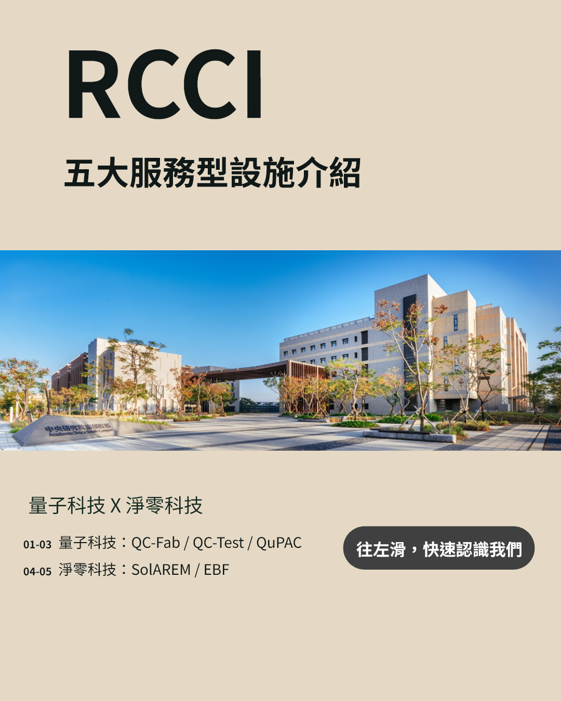

# RCCI Instagram 設計作品集

以七頁 4:5 直式貼文呈現 RCCI 五大服務型設施，包含設施介紹、照片、Logo 與查詢 QR Code。

## 線上瀏覽

啟用 GitHub Pages 後，可由儲存庫提供的 Pages 網址瀏覽。此作品集為獨立靜態網站，不需要安裝套件。

## 作品預覽

[下載可編輯 PowerPoint](downloads/RCCI_Instagram_Portfolio.pptx)

## 檔案

- `index.html`：作品集首頁
- `style.css`：響應式版面樣式
- `script.js`：點擊放大預覽
- `assets/slide-01.png` 至 `slide-07.png`：完整作品預覽
- `downloads/RCCI_Instagram_Portfolio.pptx`：可編輯作品檔
- `.nojekyll`：GitHub Pages 靜態網站設定

## 設計說明

以大字、留白與影像建立資訊層次，結尾以太空探索場景連結「探索的路上，我們與你前行」的主題。

文字與主要版面物件可編輯；照片、Logo、QR Code 及背景插畫為圖片。公開下載副本已清空編製備註與個人文件作者欄位，保留所有投影片畫面。

## 素材說明

這是設計作品展示，非 RCCI 官方網站。機構 Logo、照片與研究資訊之權利歸原權利人所有，太空背景使用 AI 輔助生成。未提供可授權全部素材的開源授權；下載作品不代表取得素材再利用授權。
